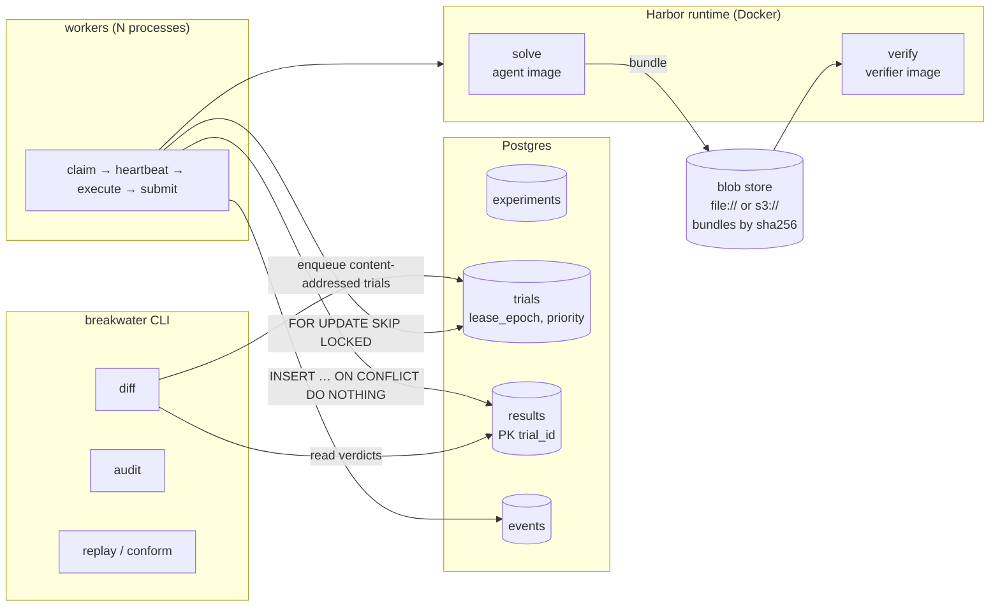
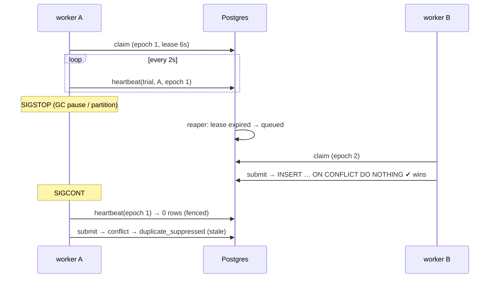
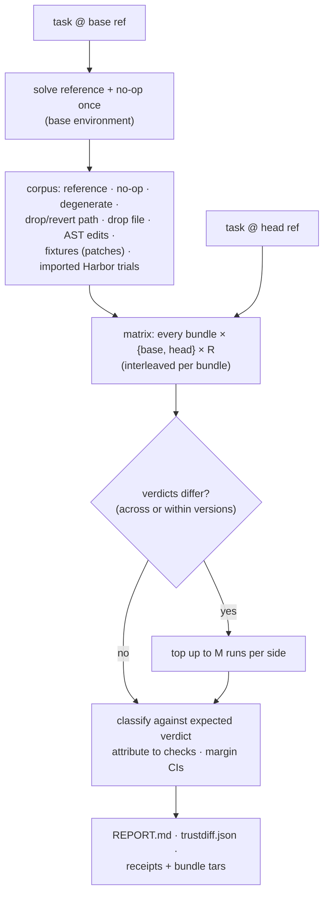

# Architecture

Breakwater has three layers, each usable on its own:

1. **A Harbor-faithful runtime** that executes benchmark tasks the way the
   official harness does, but with every input and output content-addressed.
2. **A distributed trial queue** (Postgres + Docker workers) with leases,
   fencing tokens, fair scheduling and an exactly-once result ledger.
3. **Analyses** built on the two: the **Verifier Trust Diff** (this release's
   centerpiece), the single-version falsification audit, and receipt replay.

## 1. Runtime fidelity

A verifier audit is only as trustworthy as the harness that runs the verifier.
`src/breakwater/adapters/harbor.py` reproduces harbor 0.25's single-step,
`separate`-mode protocol:

| step | Harbor | Breakwater |
|---|---|---|
| containers | compose service, `sh -c "sleep infinity"`, exec via `bash -c` | same |
| network | task's `network_mode` / `allow_internet`, default **public**; `no_network` = `network_mode: none` | same |
| resources | `[environment]` cpus / memory_mb; verifier uses `[verifier.environment]` whole, else a copy of `[environment]` | same (memory clamped to the Docker VM, recorded per trial) |
| oracle | upload `solution/` → `/solution`, `chmod +x` as root, `(/solution/solve.sh) > /logs/agent/oracle.txt 2>&1` with `[solution.env]` | same |
| collect | `[[verifier.collect]]` hooks, then archive declared artifacts + `/logs/artifacts` | same |
| upload | per artifact: directory → **emptied**, then uploaded; file → parent created; tarfile `data` filter | same |
| verdict | `reward.json` if present, else `reward.txt`; test.sh exit code ignored; missing reward = error | same |

Deliberate deltas: logs are copied out rather than bind-mounted (bind mounts
are why RewardKit's Worker fails closed on macOS hosts), `allowlist` egress
policies are not emulated (those tasks are skipped with a reason), and
multi-service / GPU tasks are out of scope.

Fidelity is tested, not asserted:

- `tests/test_harbor_adapter.py` pins each rule above (reward precedence,
  exit-code irrelevance, data-filter modes, link filtering, empty-dir shape,
  network and resource resolution).
- `breakwater conform` re-verifies recorded **official Harbor** trials —
  oracle, no-op, and Breakwater mutants regraded with `harbor trial regrade` —
  on identical bytes and compares rewards and per-check verdicts
  (`scripts/conformance.py`, results in `reports/conformance/`).
- `RUNTIME_VERSION` is part of every content-addressed trial id, so a fidelity
  fix can never be masked by a cached verdict from an older runtime.

### Bundles

A **bundle** (`src/breakwater/bundle.py`) is the exact set of bytes a
separate-mode verifier is allowed to see: every entry under the declared
artifact paths, normalized like Harbor's upload path, serialized as a
deterministic tar (sorted, mtime 0, uid/gid 0). Its sha256 is its identity.
Reference solves, no-ops, mutants, hand-written fixtures and imported Harbor
trials all reduce to bundles.

Task versions are content-addressed too (`adapters/harbor_task.py`): the
*verifier digest* covers `tests/` plus every `task.toml` field that changes
what the verifier sees or how it runs; images are tagged by build-context
digest.

## 2. The queue

At-least-once execution, exactly-once result **effect**:

- **Claim**: a fair pick across experiments — strict priority, then the
  experiment with the fewest trials *running*, ties broken by
  least-recently-claimed — and the row is taken with `FOR UPDATE SKIP
  LOCKED`. A claim never waits while holding a lock. (Plain FIFO let one
  experiment of slow trials starve every other; this happened in a real run.)
- **Lease + fencing token**: every claim increments `lease_epoch`; heartbeat
  and release must present the current epoch. `worker_id` alone is not a
  fence: a worker that restarts under the same id and re-claims a trial
  would otherwise let its old incarnation extend the new lease.
- **Reaper**: expired leases are requeued, or marked `failed` with
  `last_error` after `max_attempts`.
- **Ledger**: `results` has `trial_id` as primary key and every submission is
  `INSERT … ON CONFLICT DO NOTHING`. Execution can happen many times; one
  result counts. Submissions from superseded leases are flagged
  `stale_submission`.
- **Provenance**: every state change and its event commit in one transaction.

`report.verify_invariants()` proves, by SQL over the actual tables, that every
trial has exactly one result or is `failed`, that results reconcile 1:1 with
`result_accepted` events, and that claims reconcile with `claimed` events.
It does **not** prove exactly-once execution (impossible with crash-stop
workers and external side effects) or that a verdict is correct — that is
what the analyses are for.

Tested by `tests/test_queue.py` (32 concurrent claimers on 4 pools, real lease
expiry, same-id re-claim fencing, zombie submissions, exhaustion, fairness,
priority, query plans on 20k experiments) and `tests/test_fault_injection.py`
(seeded: 300 trials × 16 simulated workers with random stalls, crashes, double
and late submits; invariants checked continuously). The chaos demo
(`breakwater chaos`) does the same with real processes: SIGKILL one worker,
SIGSTOP/SIGCONT another.

### Why content-addressed trial ids matter

A Trust Diff cell is `td/<runtime>/<verifier digest>/<bundle digest>/r<k>`.
The ledger guarantees each id has one result ever, so:

- re-running a diff is free (cached cells are reused, not re-executed);
- diffing a third version reuses every base-version cell;
- adding one fixture to a finished diff runs only that fixture's cells;
- two machines asked the same question compute it once.

## 3. Verifier Trust Diff

`src/breakwater/trustdiff/`:

| bundle kind | expected | a change means |
|---|---|---|
| reference, AST identity control | pass | FAIL → `false_fail_introduced` |
| no-op, degenerate (empty/truncated/digit-rotated outputs) | fail | PASS → `false_pass_introduced` |
| mutant (one path dropped/reverted, one file dropped, one AST edit) | unknown | killed → passes: `strictness_regression`; passes in both: `survives_both` (candidate test gap) |
| fixture | as declared | as above |

Statistics (`trustdiff/stats.py`, no dependencies): Wilson intervals per arm,
two-sided Fisher exact test between arms, a seeded bootstrap CI on the ratio
of medians for any numeric margin (`--metric NAME=REGEX` over test stdout, plus
every numeric leaf of RewardKit's `reward-details.json`), and verifier wall
time. A change is called *deterministic* only with ≥5 agreeing runs per side
(all-vs-none at 5/5 gives Fisher p ≈ 0.008).

Why a mutant corpus: regrading historical agent trials (Terminal-Bench's
`/regrade`, community regrades) can only show **old passes that now fail**.
A verifier change that *weakens* a check produces new false passes, which
need inputs that should fail — no-ops, degenerate outputs, mutants and
fixtures — to become visible.

## 4. Receipts

Every reported change is exported with the exact bundle bytes and a receipt:
the claim, both task versions (repo, commit, verifier digest), observed
verdict vectors, and the expected replay outcome. `breakwater replay
RECEIPT` re-materializes both versions from git, checks the verifier digests,
re-runs both verifiers on the bundle and reports REPRODUCED / DID NOT
REPRODUCE. Receipts produced by a harness limitation are kept, but
quarantined (`receipts/quarantine/`), and replay labels them as harness
behaviour, never as violations.
